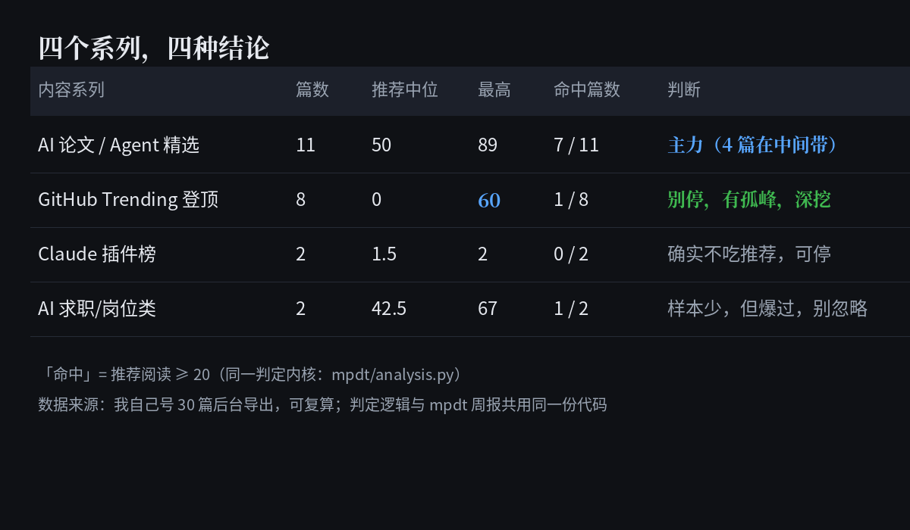

# mpdt — 公众号运营数据，抓回本机，一键周报

> WeChat Official Account analytics, fully local — fetch, store, and report your own data via one CLI.

[]()
[]()
[](https://github.com/ttxs69/mpdt/actions/workflows/tests.yml)
[]()
[]()

公众号后台（mp.weixin.qq.com）的运营数据散落在三个页面，官方不提供导出，mpdt 把它们自动抓回本机 SQLite，并生成 Markdown 周报：

- **发表列表**：阅读 / 分享 / 点赞 / 评论（实时累计口径）
- **datacube 文章级**：完读率 / 阅读率 / 送达 pv（发表后 7 天窗口，T+1）
- **单篇渠道页**：逐篇阅读人数、完读率、平均时长、渠道构成（推荐 / 搜一搜 / 公众号消息…，30 天窗口）

## 先看效果：在线自助诊断（数据不出你的浏览器）

👉 **[打开诊断工具](https://ttxs69.github.io/mpdt/self-service.html)**

公众号后台导出「已发表内容明细」→ 拖进页面 → 30 秒得到一份**带动作**的诊断报告：

- 你的号属于哪种分发结构（推荐靠抽签 / 有稳定主力 / 消息为主 / 混合）
- **哪条内容系列值得继续做、哪条该停**（按标题自动归类出系列）
- 哪些篇结构可复用、量丢在哪几篇
- 一份「不要做什么」清单

**纯静态页面，零后端**：文件在浏览器本地解析，**不上传、不存储、断网也能用**。
判定内核与 mpdt 周报**共用同一份代码**（`docs/diagnosis/kernel.js`），所以两处结论不会互相打架。

> **国内打不开 GitHub Pages？** 用[单文件版](https://ttxs69.github.io/mpdt/self-service-single.html)——
> 33 KB 的一个 HTML，下载后双击就能跑，可以微信直接转发给别人。



需要人工解读、逐篇改法或每月持续跟踪：

| | 价格 | 交付 |
|---|---|---|
| 单号诊断 | ¥499 | 24 小时（30 天内升级月度，诊断费全额抵扣） |
| 月度陪跑 | ¥1,999/月 | 每月 1 次诊断 + 4 次问答 |
| 服务商（代运营/外包） | ¥149/号，5 号起 ¥745 | 48 小时，报告可白标转给你的客户 |

> 我们不承诺阅读量、涨粉数、能不能被推荐——平台分发不受单方控制，承诺这些就是骗你。
> 我们承诺：每个数字都带分母（n），你能用自己后台复算。

## 为什么做这个

- **官方不提供导出**：后台数据只能一屏一屏翻页看，换设备、离职交接、跨年对比都无从下手
- **商业工具 ¥99/月起**：第三方 SaaS 要么按月收费，要么要求交出账号托管，个人号主用不起也不敢用
- **个人号主被忽视**：官方与商业工具都面向机构运营团队，一个人打理的号缺少趁手的本地工具

mpdt 的答案：**数据 100% 留在本机**（SQLite + 本地文件），复用你已登录的 Chrome，不托管、不上传、不收费。

> ⚠️ **口径警告**：三源同名指标口径不同（统计窗口 / 分母各异）——发表列表是实时累计，datacube 是发表后 7 天窗口 T+1，单篇渠道页是 30 天窗口。**跨源比较前先对齐口径**，周报文首附完整口径说明。

## 特性

- **零扫码**：复用本机已登录 Chrome 的登录态（CDP 远程调试），token 从页面 URL 自动刷新
- **全本地**：数据只存本机 SQLite（`~/.mpdt/mpdt.sqlite3`），凭据文件 600 权限、打印永不回显
- **幂等**：同一天重复抓取 upsert 不重复；`log_run` 记录每次运行
- **礼貌限速**：请求间隔 ≥ 1s
- **错误语义明确**：退出码 `0` 成功（含空数据）｜`2` 配置问题｜`3` 凭据/登录态问题｜`4` 上游接口异常（附原始返回片段）｜`130` 用户中断（幂等设计，重跑安全）
- **机器可读输出**：全局 `--json` 参数——stdout 恰好一行 JSON（`{ok, cmd, data, meta}`），适合脚本/管道串联
- **非交互友好**：stdout 非 TTY（管道 / 重定向 / cron）时自动静默过程输出
- **零框架测试**：170 个 unittest，零第三方测试依赖，`python3 tests/test_fetchers.py` 直跑

## 安装

```bash
# 推荐：pip 安装
pip install mpdt

# 或本地安装
git clone https://github.com/ttxs69/mpdt.git
cd mpdt && pip install .
```

> 未安装到环境时，`python3 -m mpdt` 与 `mpdt` 命令完全等价——从仓库根目录直接运行即可。

依赖：Python 3.10+、`requests`、`websocket-client`（其余全标准库）。

## Quick Start（30 秒）

```bash
# ① 以调试端口启动 Chrome 并登录公众号后台
google-chrome --remote-debugging-port=9222
#    打开 https://mp.weixin.qq.com 扫码登录，保持该标签页存在

# ② 初始化配置（生成 ~/.mpdt/config.json，600 权限）
mpdt init

# ③ 抓数据 → 出周报
mpdt fetch --backfill 7   # 抓最近 7 天（默认仅昨天，T+1 口径）
mpdt detail --recent 7    # 单篇渠道构成（最近 7 天发表的）
mpdt report               # → mpdt-reports/weekly-YYYY-Www.md
```

> 已在跑的 Chrome 需先完全退出再用该参数重启；介意隔离可用独立 profile：
> `--user-data-dir=/tmp/mpdt-chrome --remote-debugging-port=9222`

## 命令一览

| 命令 | 作用 | 常用参数 |
|---|---|---|
| `mpdt init` | 生成配置 | `--db PATH` 自定义数据库位置 |
| `mpdt fetch` | 发表列表 + datacube 文章级快照 | `--backfill N` / `--from/--to YYYY-MM-DD` / `--count N` |
| `mpdt detail` | 单篇渠道页（完读率 + 渠道构成） | `--recent N`，或 `--msgid ID --publish-date D [--item-idx 1]` |
| `mpdt report` | 生成周报 Markdown + HTML | `--week 2026-W42` |
| `mpdt export` | 导出快照 CSV（附口径元数据 `*.metrics.csv`） | `--source SOURCE --out OUT`（`--no-meta` 关闭伴随文件） |
| `mpdt metrics` | 列出全部指标及口径（按概念分组） | 可选位置参数按 概念名/显示名/源/字段 子串过滤 |

所有命令支持全局 `--json`（stdout 恰好一行 JSON）。

## 指标口径（CONCEPTS · 按概念分组）

#### 完读率（`read_completion`，单位：比例(0-1)）
> 完读率是同一概念下的两个口径，窗口与分母均不同

| series_key | 源字段 | 所属源 | 窗口 | 窗口天数 | 分母 | 备注 |
|---|---|---|---|---|---|---|
| `dc7` | `finish_read_rate` | datacube_article | 发表后 7 天窗口，T+1 出数 | 7 | 7 天窗口内阅读人数 | datacube 7 天窗口·阅读人数分母 |
| `ad30` | `finished_read_pv_ratio` | article_detail | 发表后 30 天窗口 | 30 | 阅读次数(pv) | 单篇页 30 天窗口·pv 分母 |

#### 阅读量（`read_volume`，单位：人次/次/人（按 series 而定））
> 三个 series 口径不同：实时累计 vs 7 天 pv vs 30 天 uv

| series_key | 源字段 | 所属源 | 窗口 | 窗口天数 | 分母 | 备注 |
|---|---|---|---|---|---|---|
| `pl` | `read_num` | publish_list | 实时累计（拉取时点全量） | 0 | - | publish_list 实时累计，无窗口无去重 |
| `dc7` | `total_pv` | datacube_article | 发表后 7 天窗口，T+1 出数 | 7 | - | datacube 7 天窗口·全渠道阅读次数（≈量级） |
| `ad30` | `read_uv` | article_detail | 发表后 30 天窗口 | 30 | 「全部」渠道去重 | 单篇页 30 天窗口·全渠道去重阅读人数 |

#### 分享（`share`，单位：次/人（按 series 而定））

| series_key | 源字段 | 所属源 | 窗口 | 窗口天数 | 分母 | 备注 |
|---|---|---|---|---|---|---|
| `pl` | `share_num` | publish_list | 实时累计（拉取时点全量） | 0 | - | 实时累计分享次数 |
| `dc7` | `total_share` | datacube_article | 发表后 7 天窗口，T+1 出数 | 7 | - | datacube 7 天窗口·分享次数 |
| `ad30` | `share_uv` | article_detail | 发表后 30 天窗口 | 30 | - | 单篇页 30 天窗口·分享人数 |

#### 点赞（`like`，单位：次）

| series_key | 源字段 | 所属源 | 窗口 | 窗口天数 | 分母 | 备注 |
|---|---|---|---|---|---|---|
| `pl` | `like_num` | publish_list | 实时累计（拉取时点全量） | 0 | - | 实时累计点赞数 |
| `ad30` | `like_cnt` | article_detail | 发表后 30 天窗口 | 30 | - | 单篇页 30 天窗口·点赞数 |

#### 在看（`wow`，单位：次）

| series_key | 源字段 | 所属源 | 窗口 | 窗口天数 | 分母 | 备注 |
|---|---|---|---|---|---|---|
| `ad30` | `zaikan_cnt` | article_detail | 发表后 30 天窗口 | 30 | - | 单篇页 30 天窗口·「在看」数（与点赞不同概念） |

#### 评论（`comment`，单位：条）

| series_key | 源字段 | 所属源 | 窗口 | 窗口天数 | 分母 | 备注 |
|---|---|---|---|---|---|---|
| `pl` | `comment_num` | publish_list | 实时累计（拉取时点全量） | 0 | - | 实时累计评论数 |
| `ad30` | `comment_cnt` | article_detail | 发表后 30 天窗口 | 30 | - | 单篇页 30 天窗口·评论数 |

#### 送达人数（`delivery`，单位：人）

| series_key | 源字段 | 所属源 | 窗口 | 窗口天数 | 分母 | 备注 |
|---|---|---|---|---|---|---|
| `dc7` | `send_succ` | datacube_article | 发表后 7 天窗口，T+1 出数 | 7 | - | datacube 7 天窗口·送达人数（分母=送达） |

#### 完读次数（`finish_count`，单位：次）

| series_key | 源字段 | 所属源 | 窗口 | 窗口天数 | 分母 | 备注 |
|---|---|---|---|---|---|---|
| `dc7` | `total_read_finish` | datacube_article | 发表后 7 天窗口，T+1 出数 | 7 | - | datacube 7 天窗口·完读次数 |

#### 阅读率（`read_rate`，单位：比例(0-1)）

| series_key | 源字段 | 所属源 | 窗口 | 窗口天数 | 分母 | 备注 |
|---|---|---|---|---|---|---|
| `dc7` | `read_rate` | datacube_article | 发表后 7 天窗口，T+1 出数 | 7 | 送达人数(send_succ) | datacube 阅读 pv / 送达 |

#### 阅读后关注人数（`follow_after_read`，单位：人）

| series_key | 源字段 | 所属源 | 窗口 | 窗口天数 | 分母 | 备注 |
|---|---|---|---|---|---|---|
| `ad30` | `follow_after_read_uv` | article_detail | 发表后 30 天窗口 | 30 | - | 单篇页 30 天窗口·阅读后关注人数 |

#### 收藏人数（`collection`，单位：人）

| series_key | 源字段 | 所属源 | 窗口 | 窗口天数 | 分母 | 备注 |
|---|---|---|---|---|---|---|
| `ad30` | `collection_uv` | article_detail | 发表后 30 天窗口 | 30 | - | 单篇页 30 天窗口·收藏人数 |

#### 听读人数（`listen_people`，单位：人）

| series_key | 源字段 | 所属源 | 窗口 | 窗口天数 | 分母 | 备注 |
|---|---|---|---|---|---|---|
| `ad30` | `listen_uv` | article_detail | 发表后 30 天窗口 | 30 | - | 单篇页 30 天窗口·听读人数（与听读次数不同概念） |

#### 听读次数（`listen_plays`，单位：次）

| series_key | 源字段 | 所属源 | 窗口 | 窗口天数 | 分母 | 备注 |
|---|---|---|---|---|---|---|
| `ad30` | `listen_pv` | article_detail | 发表后 30 天窗口 | 30 | - | 单篇页 30 天窗口·听读次数（与听读人数不同概念） |

#### 平均阅读时长（`avg_read_time`，单位：秒）

| series_key | 源字段 | 所属源 | 窗口 | 窗口天数 | 分母 | 备注 |
|---|---|---|---|---|---|---|
| `ad30` | `avg_article_read_time` | article_detail | 发表后 30 天窗口 | 30 | - | 单篇页 30 天窗口·平均阅读时长（秒） |

#### 赞赏金额（`praise_money`，单位：上游金额单位）

| series_key | 源字段 | 所属源 | 窗口 | 窗口天数 | 分母 | 备注 |
|---|---|---|---|---|---|---|
| `ad30` | `praise_money` | article_detail | 发表后 30 天窗口 | 30 | - | 单篇页 30 天窗口·赞赏金额 |

### 元数据字段（非指标：快照日 / 派生列 / 结构列）

| 规范名 | 字段 | 源 | 窗口 | 类型 | 备注 |
|---|---|---|---|---|---|
| `refdate` | `refdate` | datacube_article | 发表后 7 天窗口，T+1 出数 | snapshot | 文章口径日（快照行 stat_date 是拉取日，两者不同） |
| `publish_date` | `publish_date` | article_detail | 发表后 30 天窗口 | snapshot | 单篇页 30 天窗口·文章发表日 |
| `window_days` | `window_days` | article_detail | 发表后 30 天窗口 | derived | mpdt 写入的派生列（页面固定 30 天） |
| `total_read_user` | `total_read_user` | article_detail | 发表后 30 天窗口 | derived | mpdt 派生列：「全部」渠道逐日 read_user 求和 |
| `channel_breakdown` | `channel_breakdown` | article_detail | 发表后 30 天窗口 | structured | mpdt 派生列；同一用户多渠道重复计数 → 占比之和可 >100%（仅「全部」去重） |

### 旧版字段（保留登记；不参与对照 / 不出现在 metrics 视图）

> 旧版字段保留在注册表里是为了让 `mpdt/metrics.py` 仍能识别上游接口历史返回的字段（CSV 导出元数据 `*.metrics.csv` 会标出口径），但不参与周报对照、metrics 视图与自动配对。
- `old_like_num` → `like_num`：旧版字段（保留登记），口径与 like_num 相当

### 自动推导的易混淆配对（同一概念多 series）

| 概念 | 不可直接比的 series 配对 | 主要差异 |
|---|---|---|
| 完读率（`read_completion`，1 对） | `dc7` vs `ad30` | 分母、窗口 |
| 阅读量（`read_volume`，3 对） | `pl` vs `dc7`；`pl` vs `ad30`；`dc7` vs `ad30` | 分母、窗口 |
| 分享（`share`，3 对） | `pl` vs `dc7`；`pl` vs `ad30`；`dc7` vs `ad30` | 窗口 |
| 点赞（`like`，1 对） | `pl` vs `ad30` | 窗口 |
| 评论（`comment`，1 对） | `pl` vs `ad30` | 窗口 |

> 本节由 `mpdt/metrics.py` CONCEPTS 自动生成（`python3 -c "from mpdt.metrics import readme_section; print(readme_section())"`）。改口径请改 CONCEPTS，再运行 `mpdt metrics` 校对。

## FAQ

- **fetch 提示「该日期范围无数据」**：不是错误（退出码 0）。datacube 为 T+1 口径，当天数据明天可得。
- **退出码 3（AuthError）**：CDP 9222 上没有已登录的 mp.weixin 标签页——回 Quick Start ① 检查 Chrome 参数与登录态。
- **退出码 4（UpstreamError）**：微信接口返回了未识别结构——错误信息附原始返回片段，提 issue 时请一并贴出。
- **换机器 / 重置**：删除 `~/.mpdt/` 后重跑 `mpdt init`。数据库与配置都在该目录（除非 `--db` 另指定）。
- **会碰我的 Chrome 吗**：只通过 CDP 读取已登录标签页的 URL 与发起后台 API 请求，不注入脚本、不改动页面。

## 数据抓回来了，然后呢

mpdt 给你四个数：推荐命中率、中间带占比、渠道结构、完读率中位。但**数字本身不告诉你该改什么**。

举个我们自己号上的真事：30 篇文章，整体算出来命中率 33%，第一版结论是「推荐靠抽签，别优化单篇」。
按天拆开才发现——**10-17 到 10-18 连续两天、每天发 2 篇以上、推荐全部接近 0**，那是分发中断，不是内容差。
把这三天剔除后命中率是 42%；而且在正常期的同一段时间里，一类文章命中 5/5、另一类 0/7，差 4.3 倍。

**同一个数据，判错一次，接下来几个月就全花在错的方向上。**

如果你抓完数据不想自己拆这层，我们把这件事做成了一份固定交付：
四类结构判定 + 断供窗检测 + 可比期分组 + 逐篇定位 + 三条动作（和一份「不要做什么」）。

- 单号诊断 ¥499，24 小时出，每个数字都带分母，你能用自己后台复算
- 样本不足（<10 篇或 <7 个发布日）直接拒单，不出报告
- 不承诺阅读量/涨粉——平台分发不受单方控制

入口：[START-HERE](https://github.com/ttxs69/mpdt/blob/main/docs/start-here.md) ｜ 或直接开个 issue 写「诊断 + 你的号大概多少篇」。

## 文档

- [需求背景](docs/requirements.md)
- [产品需求（PRD）](docs/product-requirements.md)
- [技术设计](docs/technical-design.md)
- [冷启动记录](docs/coldstart.md)
- 答疑：[提 issue](https://github.com/ttxs69/mpdt/issues)

## 边界与合规

- 只读取**你自己**公众号后台的数据；不提供任何刷量 / 代抓他人数据能力
- 自动化访问后台属微信 ToS 灰色地带，本项目仅限个人备份分析用途，风险自担

## License

[MIT](LICENSE) © ttxs69
